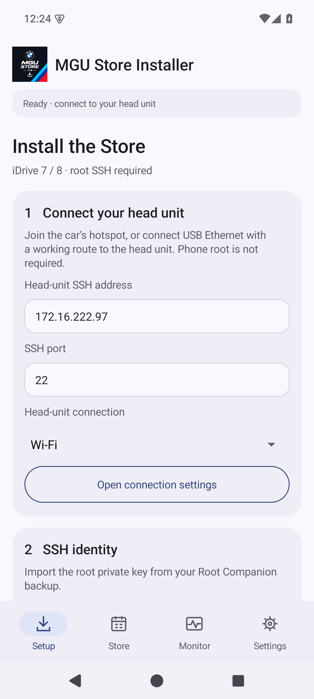
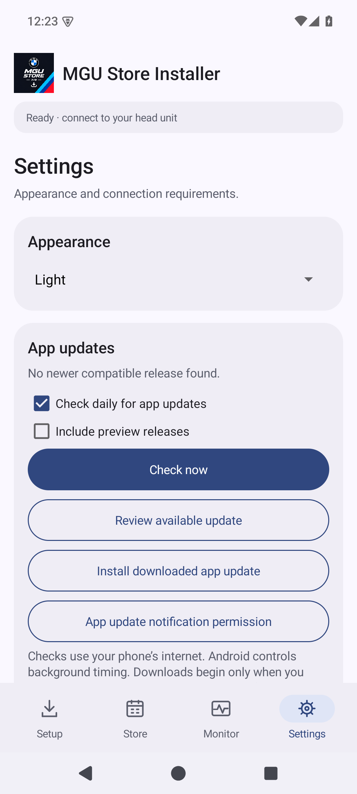

# MGU Store Installer

Android companion and first-install client for [robertnisipeanu/mgu-store](https://github.com/robertnisipeanu/mgu-store). Version **0.2.0**, 15 November 2026.

New in v0.2.0: the selected MGU STORE / BMW icon and GitHub app updater. In Settings → App updates, use **Check now** or leave daily automatic checks enabled. Downloads and installation require your choice. See [update behavior, permissions and signing requirements](APP-UPDATES.md).


**Preview release:** real-vehicle validation is pending. Existing root SSH access is required.

 

The native card layout, colors, rounded buttons, light/dark/system appearance and bottom navigation follow the locally recovered **MGU iDrive7-8 Root Companion** project. The launcher icon uses the selected MGU STORE / BMW motorsport design with a 7/8 label and installation arrow. Application ID: `dev.mgu.store.installer`; it installs alongside Root Companion.

Download the official APK from [GitHub Releases](https://github.com/statist1c/MGU-Store-Installer/releases/latest). Release APKs use the same local debug certificate as the v0.1.0 APK supplied with this project; independently generated Actions APKs may use different certificates. Preserve your private key backups and use the release channel consistently.

## What works

- Check GitHub releases manually or daily, receive update notifications and download verified APKs for user-confirmed Android installation.
- Import an OpenSSH/PEM root private key through Android's document picker; enter an encrypted key's passphrase for each operation.
- Reach the head unit over a selected Wi-Fi or Ethernet network, or Android's automatic route. SSH uses public-key authentication as `root` and a configurable port.
- Verify and pin the head unit's SHA-256 SSH host fingerprint before authenticating. Changed host keys are refused until explicitly verified again.
- Install the public published MGU Store release directly from the phone. The Android port reads the release catalog, requires every selected artifact's size and SHA-256, verifies the deploy tool's own manifest, builds a staging kit and runs the release's deploy tool. It preserves upstream's required components and optional renderer/uplink selection. Newer installed versions are retained by `--skip-older`.
- Read the deploy tool's status and request the upstream normal head-unit restart, with its install-lock check.
- View/export bounded session output. Installation runs in a foreground service with a wake lock.
- Connect to existing **Phone access** for real component/source/account state and updater logs; add a GitHub source after probing its available channels, add an HTTPS catalog, add a GitHub token, and remove non-built-in sources/accounts.

## Before connecting

You need Android **8.0+**, an **ARM64** phone (or x86-64 emulator/device), an already-rooted supported MGU head unit, root's private SSH key, valid vehicle coding, and stable phone/vehicle power. **This app does not create root access or flash firmware.** Root Companion and its backups remain separate.

For the car's hotspot, the upstream default SSH address is **172.16.222.97:22**. Select Wi-Fi and join the car hotspot. For USB-C Ethernet/ENET, Android must already have an assigned address and a working route; select Ethernet and enter the actual head-unit address. The ENET diagnostic gateway is not automatically the SSH host. This version does not implement the upstream computer installer's diagnostic host discovery, static-IP setup or SSH jump hosts.

The phone needs internet for HTTPS access to public GitHub releases. SSH is routed over the selected vehicle network; downloads use Android's default internet route. Keeping mobile data available beside a hotspot with no internet may depend on the phone. There is no offline kit import in this version. If Android cannot keep both paths available, use the upstream computer installer. Phone root is not needed.

1. Export your private Root Companion backup and securely extract the **private key file**. The key picker accepts a key, not the entire backup ZIP. Keep the original backup safe.
2. In **Setup**, enter the SSH address/port, choose the vehicle network, import the key and enter its passphrase if required. Enable legacy RSA/SHA-1 only if the unit needs it.
3. Tap **Read deploy status / check SSH**. On first use it stops at host verification. Return to Setup and compare the shown fingerprint against a separately trusted fingerprint for your unit. Save it only after that comparison; retry the operation. A missing deploy tool can make the status command fail even when SSH authentication succeeds.
4. Choose optional renderer/uplink components, tap **Install MGU Store**, review the confirmation and follow **Monitor**. Do not interrupt the connection. A remote timeout or phone disconnect does not guarantee that the remote process stopped; inspect status before retrying.
5. Check the Store on the head unit. Restart after installation if needed, then use the Store's own screen for app installation, updates and removal.

**iDrive 8:** upstream says real-car iDrive 8 support is untested and installs/removals take effect after a head-unit restart. This Android installer is also **not yet tested on any real vehicle**. Emulator and package checks do not establish vehicle compatibility.

## Phone access

On the head unit: **Store → Settings → Phone access → On**. Join the car hotspot. Scan its QR code using the phone's normal QR reader, copy the complete `http://...:8470/#t=...` link and paste it into the app's **Store** tab. This app does not include an in-app QR scanner. The token stays in memory and is forgotten when disconnected or the process ends. Refresh manually for new state.

The upstream HTTP API allows sources/accounts/proxy operations, state and logs. It **does not expose install, update, remove-app, check-now or restart operations**. This app therefore performs app management on the head unit's Store screen. Its separate Setup restart uses authenticated SSH. This version does not implement every upstream phone-page feature (proxy editing and GitHub device login are omitted); GitHub token accounts are supported.

Phone access is plain HTTP by upstream design. Use a trusted vehicle hotspot, avoid sharing its bearer link, and turn Phone access off when done. API requests are restricted to literal private IPv4 destinations, never follow redirects, and send tokens only in the Authorization header. The server may rate-limit invalid tokens; obtain a new link after Phone access rotates its token.

## Privacy and recovery

Imported keys live in Android private app storage. Android cloud backup and device transfer are excluded. The key is not stored in the Android hardware keystore: a rooted/compromised phone can access app data. Passphrases are not saved. The app can delete its imported key and saved host pins in Settings. Do not clear app data or uninstall until you have your own key backup.

Session output is in memory, limited to the most recent 500,000 characters; export it before leaving the session. Process death loses that output. Android may stop a foreground service despite a wake lock. Do not blindly retry after an interrupted installation. The generated kit is removed from the phone on normal success/failure; upstream deploy cleanup handles abandoned remote staging folders. The app does not uninstall the Store or restore vehicle coding.

## Build from source

Install **JDK 17**, **Python 3.13**, Android SDK platform **35**, and Android build tools. Set `JAVA_HOME` and `ANDROID_HOME`, or configure the SDK in Android Studio. Internet is needed for the first dependency download. The project uses Gradle 8.9, Android Gradle Plugin 8.7.3, Chaquopy 17.2.0, JSch 2.28.8 and Bouncy Castle 1.87. Python is embedded in the APK; end users do not install Python or Termux.

On Windows from `android/`:

```powershell
.\gradlew.bat "-PbuildPythonPath=C:/path/to/python313/python.exe" assembleDebug lint
```

On macOS/Linux:

```sh
sh gradlew -PbuildPythonPath=/path/to/python3.13 assembleDebug lint
```

APK: `android/app/build/outputs/apk/debug/app-debug.apk`. The supplied APK is a **debug-signed preview**, suitable for sideloading/testing; production distribution needs your own signing key. No signing private key is included. A fresh developer's debug key may differ, requiring uninstall before installing their own build; back up the imported SSH key first.

Tests:

```sh
python -m unittest discover -s tests -v
```

The Android instrumentation smoke test verifies embedded Python, packaged commands, SHA-256, URL validation and live GitHub HTTPS metadata. It requires an emulator/device with internet:

```powershell
.\gradlew.bat "-PbuildPythonPath=C:/path/to/python313/python.exe" assembleDebug assembleDebugAndroidTest
adb install -r app/build/outputs/apk/debug/app-debug.apk
adb install -r app/build/outputs/apk/androidTest/debug/app-debug-androidTest.apk
adb shell am instrument -w dev.mgu.store.installer.test/dev.mgu.store.SmokeTest
```

The non-vehicle integration check `python tools/verify_published_release.py` downloads current public packages, validates them and inspects a generated kit with a mocked SSH adapter. It never connects to a vehicle.

Source reference: upstream commit **fc5750a8474359ad20c1c01cf29d997ff7f2d621**. `vendor/mgu-install.js` is retained for audit. `upstream_commands.json` contains its verbatim `RUN_SH`, `CODING_CHECK` and `RESTART` constants; `sources.json` comes from upstream. Android orchestration is in `installer.py`; SSH and UI are native Java.

Differences from the computer installer: public catalog releases only, every artifact must have a SHA-256 (no legacy release-list fallback), explicit IPv4 host/network selection, and a coding check must positively return `ok`. Missing or unrecognized coding checks stop installation. No private release download, USB repository creation/import, token bootstrapping during installation, automatic tile-readiness verdict or automatic restart. Status output is shown for review; command success alone does not prove a working Store tile.

## License and provenance

GPL-3.0-or-later, following upstream. See `LICENSE` and `THIRD_PARTY_NOTICES.md`. This is an independent companion; it is not affiliated with BMW. Native UI work follows the user's previous Root Companion design. No BMW SDK, firmware, vehicle key or signing secret is included.
